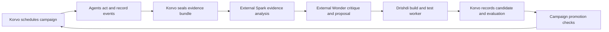

# Flockinator continuous experiment laboratory

Proposed capability boundaries for review, 4 November 2026. This is an extension
of [the existing capability map](CAPABILITY-MAP.md), not an approved implementation
specification or a claim that the pipeline exists. Scope is the non-weaponized
communication, cooperative sample-recovery and learning laboratory.

## Ownership

The Korvo is the authoritative runtime and operator console. It hosts all web
assets, experiment configuration, the bounded simulation, scheduling, live
metrics, durable evidence indexes, job state and deployment controls. Browsers
render the visualizations; closing them cannot advance, pause or lose a run.
The LCD remains a live status display and physical backup control. Both control
surfaces use the same command service and record operator interventions.

An external worker handles large-model requests, repository changes,
compilation and expensive statistical analysis. The owner selected Drishdi running
HERDR, with sixteen tiered Muse node assessors and a Wonder Full coordinator, on
4 November. This supersedes the earlier proposed default of Vivek. Drishdi also
provides the larger browser display. Worker availability must not gate
running an installed experiment. Pending review/build jobs remain visible and
resumable on the Korvo. The worker does not become a second fleet controller.

Use the four reviewer tiers recorded in the [HERDR brief](docs/operations/drishdi-herdr/README.md)
for node evidence analysis and Wonder Full for consolidated research decisions.
The installed harness uses subscription OAuth for Full and API credit for worker
lanes. Record exact model identifiers, effort, prompts and request provenance.
The [readiness report](docs/operations/drishdi-herdr/READINESS.md) distinguishes
live lane availability from new inference and end-to-end campaign verification.

## Capability map

Existing module identifiers remain unchanged. New modules are explicitly marked.
Dependencies below are provider interfaces, not the feedback arrows in a research
cycle. They form an acyclic implementation order.

| Module | Responsibility in this extension | Depends on |
| --- | --- | --- |
| node-platform | Local decision/event records, durable SD spooling, sequence numbers, firmware identity and recovery health | — |
| flock-network | Separate management, experimental messages and bulk evidence; delivery/acceptance observations | node-platform |
| agent-runtime | Explicit controller/local/hybrid execution mode, bounded world and private agent state, versioned policy/model memory | node-platform, flock-network |
| experiment-faults — new | Reproducible application-message faults and registered dishonest test participants; Kulira adapter later | flock-network |
| experiments | Campaign queue, immutable run manifests, evidence ledger, paired evaluations and population summaries | agent-runtime, experiment-faults |
| analysis-review — new | External Spark/Wonder jobs, evidence citations, proposals, build provenance and review outcomes | experiments |
| cluster-deployment | Image catalogue, compatibility checks, canary deployment, measured health, promotion and recovery records | node-platform, flock-network, experiments |
| management-console | ESP32-hosted website, live presentation and shared LCD/web command service; truthful workflow/capability display | experiments, analysis-review, cluster-deployment |

Build order: durable evidence and version identity; campaign/evaluation services;
console over those services; external review/build integration; deployment
tracking and canary release; controlled Kulira experiments. Local agent execution
is a separately measured milestone within agent-runtime, not implied by SD copies.

## Current evidence and gaps

- Korvo 0.9.0 already hosts fleet commands, a tabletop planner, a communication
  lab and planner ZIP archives. The latest read-only check found sixteen panels
  online on 0.10.2-journal, the fleet Idle, two planner archives and the current
  learning run complete at round 80. These are observations, not lifetime totals.
- Learning currently runs centrally on the Korvo. Panels display scripted state
  and store controller-generated journals. Per-node native decision making and
  local decision/communication logging still need implementation and validation.
- Learning checkpoints reconstruct the current seeded run. They do not provide a
  durable history of all completed, aborted or overwritten learning runs.
- Panel partitions contain ota_0/ota_1 and enable rollback. The Korvo partition
  table contains only a factory application. Controller self-update/rollback
  requires a separate partition/bootloader migration and recovery proof.
- The tested controller image occupies about 61% of its 4 MiB app partition.
  The board has 16 MiB flash and 16 MiB PSRAM. This establishes feasibility for a
  lean console, not capacity for every proposed feature simultaneously. Measure
  heap low-water marks, tick deadlines, SD backlog and HTTP latency under load.

## The research record

Every campaign links a hypothesis, predeclared metrics, scenario distribution,
training seeds, held-out seeds, baseline and candidate versions. Every episode
records the world seed, fault seed, execution mode, node identities, firmware
digests, policy/configuration digests, initial memory snapshot, evaluator version,
timing and terminal outcome. Interrupted and invalid runs remain in the ledger.
Import legacy evidence as legacy evidence; do not invent historical counters.

Event records contain node/run identity, monotonic sequence and tick, UTC with
clock-quality information, observations available at the time, chosen action,
concise policy reason code, and memory update identifiers. Communication records
distinguish send attempts, delivery, rejection and consumption by a decision.
Missing sequence ranges and log overflow are visible. Store director truth
separately from information available to agents. Explanatory text from a later
review is attributed to that reviewer, never substituted for a node's own trace.

The console distinguishes experiment executions, completed valid evaluations,
review iterations, candidate policies, built images, installations and rollbacks.
Receiving an image, booting it, passing a health check and improving a benchmark
are separate events.

## Evidence of improvement

Use a capability profile, not a single invented intelligence level. Show the
installed model/policy revision alongside results and sample sizes.

| Dimension | Evidence to report |
| --- | --- |
| Individual competence | Held-out sample-sector choice accuracy, uncertainty calibration where available, abstention and recovery behavior |
| Cooperative benefit | Paired improvement over private-cue and fixed-policy baselines, at matched observation and message budgets |
| Communication | Delivered and consumed messages, stale/duplicate/rejected messages, simulated latency or measured latency with clock uncertainty |
| Learning | Performance versus training exposure, retained capability, unseen-scenario generalization and regression on earlier tests |
| Resilience | Performance under each declared fault condition, misleading-message acceptance, recovery time and degradation relative to clean trials |
| System cost | Decision time, memory, message volume, log completeness and simulated resource cost clearly separated from physical measurements |
| Release quality | Build/test outcomes, canary health, failed boots, recovery events and post-release evaluation results |

Compare candidates on matched held-out scenarios, retaining the same random
inputs where appropriate. Treat independent episode/seed replicates as the
statistical units; agents on the same team are correlated. Report uncertainty
and failures, including sparse and empty scenarios. Do not infer a multi-agent
advantage from packet counts, synchronized animation, extra observations or an
independence formula that the experiment has not justified.

Keep parameter adaptation within a run, memory retained between runs, and changes
to firmware/policy between versions distinct. Review models can propose an
improvement; only a reproducible evaluation can establish one. Bookkeeping must
show inconclusive and worse outcomes as readily as improvements.

## Review and release loop

External jobs reference sealed evidence hashes and retain their input/output
provenance. Logs, including Kulira payloads, are untrusted data. Review outputs
cannot execute commands, change credentials or install an image by themselves.
Candidate code is built and tested in an isolated worker before it becomes an
installable artifact. Every release retains its parent, test results and recovery
compatibility. Prefer a versioned policy/configuration change when no firmware
change is necessary. Initial rollout is one canary node before a wider deployment.
The operator can make these decisions from the Korvo website.

## Kulira and the friction hypothesis

Begin with reproducible application-level loss, delay, duplication, reordering,
corrupted content and contradictory reports in the experiment channel. Kulira
can later be a registered test participant on the lab network. A participant
with a valid identity that reports false observations tests a different failure
mode from an unauthenticated identity that should be rejected.

Management, stop commands, firmware recovery and evidence export remain separate
from the experimental channel. No shared-network jamming, credential theft or
unbounded impersonation is part of this proposal. The director records injected
faults without revealing their truth to agents during the run. Injection time,
seed, intended recipients and actual delivery are replayable.

Friction is a hypothesis to test. It can encourage robustness, but can also
destroy useful information or teach the wrong associations. Compare clean and
impaired training crossed with clean and impaired testing, plus no-learning
controls. Keep novel faults held out and report whether resilience gains cost
clean-condition performance. This does not establish general intelligence or
transfer to real aircraft or operational targeting.

## Console direction

A restrained research-instrument aesthetic: dark ink, warm neutral surfaces,
legible system typography, monospaced identifiers, cyan for observations and
amber for interventions. Color always has text or symbol equivalents. Reuse
the existing palette where it supports that hierarchy. Bundle assets locally;
the live site must not depend on CDNs, model providers or the build worker.

Persistent navigation covers Observatory, Experiments, Agents, Evidence,
Reviews and Releases. The Observatory gives the live world most of the space,
with a compact event stream, experiment condition, runtime health and real
counters. Comparisons show distributions and baseline/candidate differences.
Reviews show cited findings and proposal status. Releases show each physical
node's reported image, candidate stage and recovery capability. Unimplemented
features are clearly identified; no decorative live metrics or fake histories.

The LCD concentrates on current experiment, phase, fleet health, log backlog,
network address and stop/pause/resume. The website provides detailed planning,
evidence inspection and release management. Live rendering is rate-limited and
can pause visually without pausing the experiment.

## Owner direction and operational handoff

The owner selected Drishdi/HERDR, sixteen tiered Muse assessors, Wonder Full coordination
and evaluation of both homogeneous and heterogeneous variants. The Korvo remains
the runtime/web host. The [Drishdi operational brief](docs/operations/drishdi-herdr/README.md)
defines evidence collection, role prompts, tool boundaries and the staged
research/release loop. This records the requested direction; it does not assert
that model access, adapters or autonomous deployment are configured. Credentials,
API budget and actual HERDR interfaces remain integration inputs. The fleet stays
stopped while the handoff is prepared.
