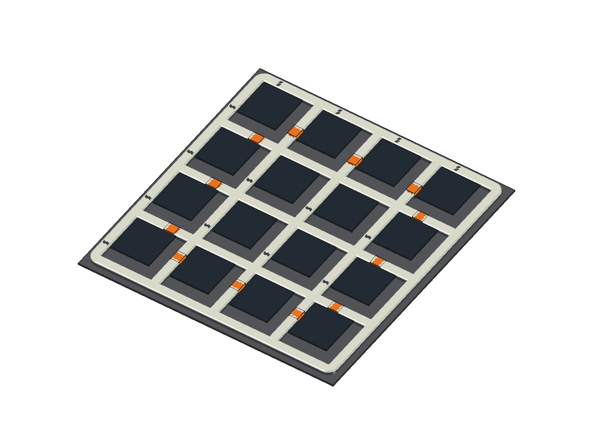

# Flockinator

**Meta Global AI Developer Hackathon 2026 · Indie Developer track · Push the Frontier · solo**

An experimental platform for intelligent agents and distributed
inference, built and directed with Meta Muse models.

Sixteen independent ESP32-S3 nodes each drive a 64x64, 160x160 mm RGB
panel. Each node is a physical body - sensing, local state, display,
audio, SD storage - whose brain can run locally, on an external host,
or across both. A Korvo-1 (ESP32-S31) controller hosts the fleet controls,
planner, and learning lab; a LilyGo handheld provides portable
management. The fleet is visualised as a fictional search-and-rescue scout swarm
so humans can watch agents learn. **The quadcopter mission is a visualisation
only - no aircraft is flown.**

Add-on sensors (LiDAR/ToF, mmWave, thermal, camera) are ordinary I2C
devices: one or more can be fitted to any node to sense presence where
an experiment needs it. The quadcopter scenario itself runs on a shared
virtual-world simulation, so these sensors do not change any published
result below; they serve presence-sensing experiments.



## Why

Small models are trained in isolation, then judged by a hostile world.
Kulira, the adversarial host, injects graded friction - interference,
impersonation, and false reports on the experimental channel - so the
swarm must earn trust: validate identity, corroborate independently,
degrade gracefully, recover. It is nature's optimisation story
(hardship and selection) compressed into seeded, reproducible runs,
studying intelligence in the node, external to the node, and between
nodes. Full method and why this is worth doing (security, and the
extra-node intelligence that lives between agents, not inside them):
[docs/experiments.md](docs/experiments.md).

## Results so far (simulation replay, not on-node inference)

Planner scorecard against sealed ground truth; full method, gates, and
field observations: [docs/results/](docs/results/README.md) ·
[dashboard](https://guruswami-ai.github.io/flockinator-public/results/).

| Candidate | Sighted recall | Committed Enemy→Friendly | Verdict |
|---|---|---|---|
| Frozen baseline `search-board-1` | 0.2141 | 0 | Production reference |
| Sector partition v1 | 0.6226 | 0 committed (sighted rate rose) | Rejected |
| Sector + confirmation v2 | 0.6145 | 2 | Rejected (gate 4) |
| Sector + adaptive re-check v3 | 0.5971 | 2 | Rejected (gates 4-5) |
| Asymmetric commit v4 | 0.5971 | 1 | Rejected (gates 4-5) |

The hard gate is committed Enemy→Friendly = 0; no candidate clears the
full gate set yet. Coverage improved roughly threefold; judgement at
60-82% per-sighting identify accuracy is the open problem.

## Known limits

- Scorecard numbers are simulation replay designed against live
  telemetry, not on-node inference results.
- Extra-node paired gain (communicating swarm vs isolated agents at
  matched budgets) is defined in [docs/experiments.md](docs/experiments.md)
  but not yet measured; no number is claimed for it.
- Experiment-catalogue entries needing add-on sensors or proposed
  DIG/CARE states are flagged simulation-only until fitted
  ([docs/experiment-catalogue.md](docs/experiment-catalogue.md)).

## Meta Muse models

A sixteen-lane Muse swarm (Wonder and Spark tiers, coordinated by
Muse Wonder Full) mirrors the physical swarm: one assessor per node,
sealed evidence, cited claims, canary deployments. Muse models helped
build the firmware, model the 3D hardware, troubleshoot nodes, and
direct the experiments. Evidence and reproduction:
[docs/meta-muse/](docs/meta-muse/README.md).

## Learn the ideas first

New to swarms? [Learn: swarms, shared intelligence, and trust](docs/learn/README.md) - plain-language help pages with pictures, no background needed.

## Explore

| Area | Entry point |
|---|---|
| Architecture and traffic classes | [docs/architecture.md](docs/architecture.md) |
| Experimental methodology | [docs/experiments.md](docs/experiments.md) |
| Results dashboard and methodology | [docs/results/](docs/results/README.md) |
| Illustrated survey scenario | [docs/scenarios/quadcopter-survey/](docs/scenarios/quadcopter-survey/README.md) |
| Hardware, components, finished CAD | [docs/hardware.md](docs/hardware.md), [cad/](cad/README.md) |
| Build and host tools | [docs/build.md](docs/build.md) |
| Firmware | [firmware/node-platform](firmware/node-platform/README.md), [firmware/korvo-monitor](firmware/korvo-monitor/README.md), [firmware/management-console](firmware/management-console/README.md) |
| Browser preview | [previews/recon-hud](previews/recon-hud/README.md) |
| Attack taxonomy and A2A asymmetry | [docs/attack-taxonomy.md](docs/attack-taxonomy.md) |
| Adversary (Kulira) and friction plan | [docs/kulira-friction.md](docs/kulira-friction.md), [tools/kulira-core](tools/kulira-core/README.md) |

## Quick start

```sh
uv run --project tools/node-commissioner python previews/recon-hud/serve.py
# open http://127.0.0.1:8766/
```

## Scope of this repository

A public subset of a private working project: firmware, host tools,
finished 3D models, and experiment design - everything needed to
reproduce the experiments and build the hardware. Private per-node
data (identities, keys, network inventory, raw backups, real-node
journals) and licensed third-party assets are never published here.

## Licence

Apache-2.0 (see [LICENSE](LICENSE)); third-party components retain
their own licences. Contributions: [CONTRIBUTING.md](CONTRIBUTING.md).
Security: [SECURITY.md](SECURITY.md).
