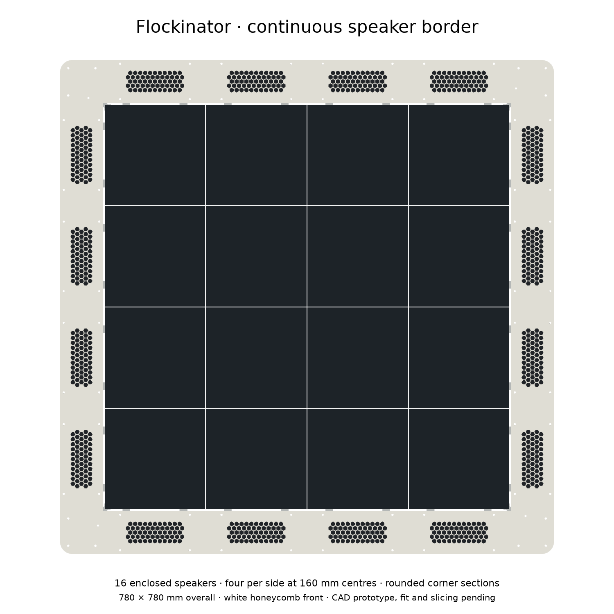
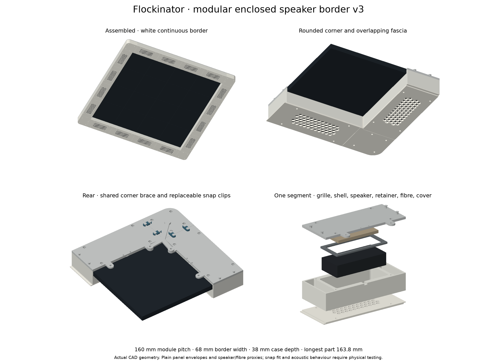

# Continuous speaker border — prototype v3

The sixteen speaker boxes now form a continuous white border with rounded corners. Four speakers sit at **80, 240, 400 and 560 mm on every edge**, centred on the four panels. Each speaker keeps its own enclosed chamber, while overlapping fascia joints hide the 0.4 mm assembly gaps. Small replaceable rear clips connect neighbouring sections.

**This is a CAD-validated first-fit prototype. It has not been sliced, printed, physically fitted or acoustically tested.** Start with the snap coupon, then one corner and two straight enclosures. The existing T/X joining models remain unchanged. This replaces the v2 protruding-speaker arrangement for the temporary touching-panel array.




## Size and mounting

- Touching panel array: **640 × 640 mm**.
- Border: **780 × 780 mm** overall, **68 mm** wide, **2 mm** from the panel edge, outer corner **R20**.
- Straight pitch: **160 mm**; shell length **159.6 mm**. Longest print: **163.8 × 68 × 3 mm** front grille, including its overlap tongue.
- Enclosure front/rear: **−35 / +3 mm** relative to the nominal panel rear mounting-contact plane; 38 mm overall case depth. Actual panel front thickness is not established by the reference slab used in the renders.
- Rear clip-post limit: **+7.3 mm**. Corner brace: **+6.3 mm**, before screw heads and washers. Compare the whole installed stack with the actual whiteboard gap; the 12 mm magnetic standoff length alone is not a measured clearance.
- Two M3 panel holes per straight: **90 mm apart**, centres **7 mm inboard** from the panel edge. Their offsets from panel centre along the edge are ±45 mm. Printed clearance holes are Ø4 mm.
- Each corner's raised brace shares the two closest edge screws with its adjoining straight covers. Their local corner coordinates are (35,7) and (7,35). Corner shared stack is 6.3 mm before washers; ordinary straight tab thickness is 3 mm.

The user reported recessed/inlaid edge mounts. **The depth and usable seat diameter still need measuring.** Supplied Ø10/Ø4 × 1 mm and 2 mm spacer rings are trial options, not a declaration that either fits. Support each tab on the actual mounting seat without flexing it. Select panel screws from the measured stack and permitted thread engagement; no assumed universal screw length is supplied. Old perimeter T pieces can occupy these same M3 holes: use the new tabs in their place, rather than stacking parts without checking the geometry. Interior X pieces remain part of the panel assembly.

The [official Bambu X2D specifications](https://blog.bambulab.com/xcellence-made-simple-bambu-lab-presents-the-x2d/) list a 235.5 × 256 × 256 mm shared dual-nozzle volume, and 256 × 256 × 260 mm with the main nozzle alone. All individual parts fit within the smaller envelope. This verifies size only; it does not select a printer profile or validate toolpaths.

## Files and quantities

Use the `parts/` STL files at **100%, millimetres**. Each also has a STEP and FreeCAD solid. STLs have minimum Z at the bed, whereas STEP/FCStd retain assembly coordinates. Do not print the complete assembly, reference meshes, speaker proxy or fibre proxy.

| Part stem after `Flockinator-`, before `-v3` | Full border quantity | Purpose |
| --- | ---: | --- |
| straight-shell | 16 | Closed-sided chamber, cable passage, hollow side bays |
| straight-grille | 16 | Protective honeycomb front with shiplap overlap |
| speaker-retainer | 16 | Padded rigid-casing retention |
| straight-rear-cover | 16 | Closed back, two panel tabs, four snap posts |
| corner-shell | 4 | Rounded front and surrounding walls |
| corner-rear-cover | 4 | Closed back and raised two-screw panel brace |
| snap-bridge | 40 | Two removable rear bridges at each of 20 joints |
| snap-bridge-loose | Alternative | Same bridge with wider 3.6 mm throat instead of 3.2 mm |
| snap-test-posts | 1 test | Two posts with the same Ø4 necks and Ø6 caps as the assembly |
| spacer-1mm / spacer-2mm | As measured | Mount-seat trial rings |

`Flockinator-continuous-border-v3.FCStd` contains the complete border, linked part definitions and simplified panel reference slabs. The builder is the editable dimensional source; solids are generated geometry, not a hand-authored sketch/constraint feature tree. Reference slabs omit ESP32s, magnets, cables and original X pieces, so the assembly is not a full electronics collision model.

## Print settings and colour

Use the requested **50% gyroid infill and five wall loops**. `print-settings.json` is a readable requirements record, **not an importable Bambu Studio profile**. Start from the actual printer/nozzle and Bambu filament presets; inspect the preview before printing. Five loops may fill thin walls and grille webs completely. Infill percentage does not mean half the CAD volume becomes plastic.

The preview uses a white shell, white grille and white corners with dark speaker surfaces behind the honeycomb. Use the available **Bambu PLA Basic Jade White** for that first appearance sample; black/charcoal is an alternative grille colour if a stronger contrast is wanted. Use Basic rather than Matte for the first clip trial and compare actual flex before committing to a batch. No material durability or clip-cycle performance has been established.

Suggested STL orientations are already supplied:

- Shell: front seating rim down, open rear up. Inspect cable exit bridging; keep the acoustic chamber clear of support residue.
- Grille: front face down. The female shiplap recess has a shallow overhang: locally support it if required by the selected profile, without filling the honeycomb apertures. Remove residue without changing the mating dimensions.
- Straight rear cover: retaining posts down. It needs supports beneath the elevated plate and tabs. Keep supports off nut pocket walls and mounting bores where possible.
- Corner shell: front down, open rear up; review support under the female overlap edge.
- Corner rear cover: inner face down. Support the raised rear brace and its pads; review post-cap overhangs.
- Retainer, clip bridges, spacer rings and test-post coupon: supplied flat orientation. Inspect cap overhangs on the coupon. Clip arms must not be bonded to supports or brim.

These support notes are requirements for slicer review, not a tested support recipe. No G-code, mass estimate or print duration is included.

## Speaker, damping and fasteners

The shell surrounds front, sides and rear apart from deliberate front acoustic openings, screw bores and the **6 × 3 mm rear-seam cable outlet**. Pad/seal the cable outlet after routing; FDM joints are not claimed airtight.

Design speaker envelope is 99.5 × 44.8 × 21.3 mm, accommodating the owner's 98 × 44 × 20 mm measurement. Central cavity is 104 × 50 mm. Use thin closed-cell foam strips only on the rigid casing perimeter against the front lip and retainer. Nominal reference-envelope front gap is 1 mm to the seating lip; rear foam gap is 1.7 mm (about 3 mm for the smaller measured body at the same front position). Confirm the actual housing surfaces before compressing foam. Neither moving surface should touch the guard, foam, retainer or fibre. Grille inner surface is nominally 3 mm ahead of the reference speaker front.

The rear central reservation for loose acoustic fibre is **80 × 26 × 5 mm**. It passes through the retainer's open centre, stays 1.2 mm behind the reference body and 0.5 mm ahead of the rear cover. Secure it lightly so it cannot migrate into vents or moving parts. Compare sound with and without fibre; the kit speaker may already contain an acoustic rear chamber, so no bass improvement is assumed.

Each enclosure/corner uses four **M3 through screws**, Ø3.4 printed clearance and **5.8 mm across-flats, 2.6 mm deep rear hex-nut seats**. Case screw pattern is 110 × 56 mm. M3 × 40 screws are a starting fit choice for the 38 mm front-to-rear stack, with suitable washers; check actual head seating, nut engagement and protrusion. Hardware is not modelled. Full border has 80 such case screws and nuts. There are 32 panel mounting positions; the eight corner brace holes share eight of those positions, not eight additional panel holes.

## Assembly order

1. Print the snap coupon and both clip variants. Test sliding a bridge sideways over both necks below their caps. It must retain without cracking, whitening, excessive force or unacceptable looseness. Do not force the tighter option. Choose one fit only after the physical test; both variants have identical static neck clearance, different entry throats.
2. Print two complete straights and one corner, sufficient to test either a straight join or the two edges of one corner. First confirm rear-tab seats and bolt engagement on the actual panel before installing the speaker.
3. Place the front grille against the shell. Add perimeter foam, speaker, retainer and lightly restrained fibre. Route the lead through the inner cable exit, leaving service slack. Secure the lead at the two nearby tie holes. Fit rear cover and four through screws, compressing foam only enough to prevent rattle.
4. Arrange two straights on adjacent edges of one corner panel. The top-left corner has a male tongue toward the first top section and a female recess receiving the last left section. Rotate this same pattern around the array; do not mirror the parts. Male and female front laps must seat without bending.
5. Slide the rear bridge clips over each paired set of posts: two clips per join. Fasten the straight tabs to their edge mounts and the raised corner brace over the shared tabs. The clips align and retain joints; panel screws carry the local support load.
6. For the full ring, leave fascia/case screws loose until all overlapping edges are seated. The removable straight grille permits closure of the last shiplap joint. Finish tightening only after the ring sits square without preload. Remove from the whiteboard to access rear clips or service wiring.
7. Test cable reach and rear clearance, diaphragm freedom, buzz/rattle and repeated clip removal on this sample. Do not extrapolate a CAD pass to the magnetic holding capacity of the completed assembly. Record any needed dimensional changes before batch printing.

Keep the supplied 150 mm leads when they reach with service allowance. Central B2/B3/C2/C3 require extensions; other routes depend on actual ESP32 connector placement. `speaker-routing.csv` is a proposed bijective map, not a measured cable schedule. Preserve polarity, insulate soldered extensions, label both ends and restrain the cable independently of its terminals.

## Validation and provenance

`validation.json` records valid single solids, STEP reimport validity, watertight connected STL meshes, edge bores independently recovered from STL sections, speaker/fibre and part clearances, adjacent joints and the corner neighbourhood. `check_step_assembly.py` reimports the delivered STEP files and checks all component pairs in a corner neighbourhood including its four clips, plus shared screw access. Static checks cannot model clip flex, creep, sound, print shrinkage or real board obstructions.

Panel mounting dimensions come from Waveshare's P2.5 DWG and the corrected panel-hole review, not the discarded v1 hole layout. Drawing SHA-256: `ff21d199516ebd563c5bbe0ff118daf3771337165403ea4d60e621ee905582d7`.

Speaker-envelope source: [Francois Stander — Waveshare 8Ω 5W speaker](https://www.printables.com/model/1274311-waveshare-8o-5w-speaker/files), CC BY 4.0; adapted here as a simplified dimensional proxy, supplemented by owner measurements. The downloaded lual enclosure is reference only; none of its mesh is included in these solids. New enclosure geometry and generator are GPL-3.0-or-later; see included license.

Regenerate in order using the full commands in `SPEC.md`, then run:

```sh
/Applications/FreeCAD.app/Contents/Resources/bin/python /Volumes/devops/flockinator/cad/perimeter-speakers/border-v3/check_step_assembly.py
uv run /Volumes/devops/flockinator/cad/perimeter-speakers/border-v3/package.py
```
