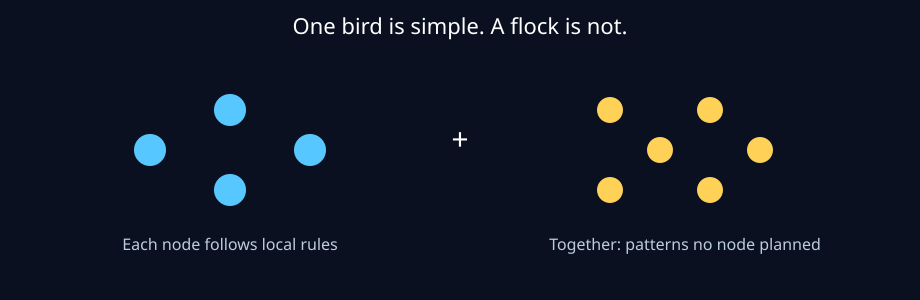

# Why groups look intelligent

A single node in Flockinator is not clever. It can sense a little,
remember a little, show a picture, and talk to its neighbours.

Yet put sixteen together and patterns appear: waves of agreement,
sudden turns, groups forming and splitting. This is **emergent
behaviour** - the pattern comes from the interactions, not from a
hidden master plan.

Three local habits create most flock behaviour in nature and here:

- **Stay close** to neighbours, but not too close.
- **Match** roughly what neighbours are doing.
- **Share** what you just sensed, quickly and briefly.

No node decides "the flock will turn left now". The turn is what
all the local decisions add up to. That is why it can happen faster
than any single decision-maker - human or computer - could plan it:
there is no centre to wait for.

Flockinator matters because we can replay the same moment with one
rule changed - share less, doubt more, lose two nodes - and measure
whether the group pattern gets smarter or falls apart.
